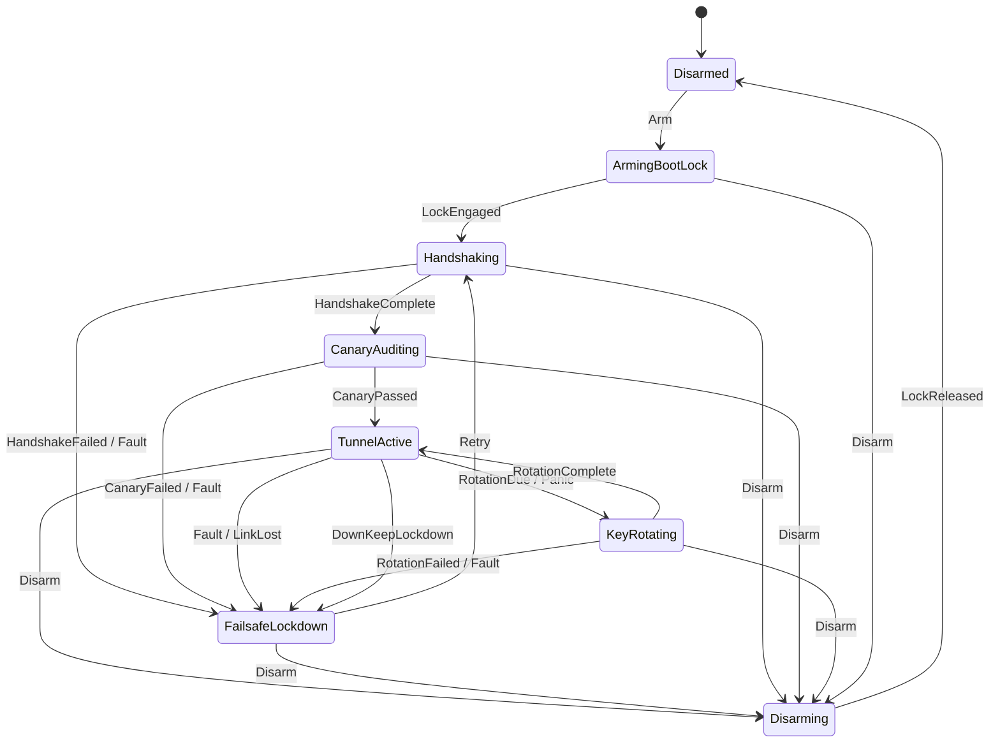

# VoidWire Architecture

This is the contract between crates. Wire formats here are normative: code must
match them byte for byte, and tests should assert them.

## 1. Process model

```
 ┌──────────────┐  ┌──────────────┐  ┌─────────────────────┐
 │ voidwire CLI │  │ voidwire tui │  │ VoidWire.app / .exe │  (unprivileged)
 └──────┬───────┘  └──────┬───────┘  └──────────┬──────────┘
        └────── VWIPC (framed JSON, HMAC challenge auth) ──┘
                          │  macOS/Linux: /var/run/voidwire/voidwired.sock
                          │  Windows:     \\.\pipe\voidwired
                 ┌────────▼─────────┐
                 │    voidwired     │  root / LocalSystem (launchd, Windows service)
                 │  Iron Dome FSM   │
                 │  packet pipeline │──► FirewallBackend (pf / WFP / nftables)
                 │  optimizer       │──► TUN (utun / Wintun / tun) "vw0"
                 └────────┬─────────┘
                          │ StealthTransport (UDP / AWG / MASQUE / TLS-WS) + DAITA
                 ┌────────▼─────────┐        ┌──────────────────┐
                 │  Hop 1 (entry)   │──UDP──►│  Hop 2 (exit)    │──► Internet
                 │ voidwire-node or │        │ voidwire-node    │
                 │ Cloudflare WARP  │        │ (self/F2F/free)  │
                 └──────────────────┘        └──────────────────┘
```

## 2. Iron Dome finite state machine (`vw_core::state`)



- `traffic_allowed()` is true only in `TunnelActive` and `KeyRotating`.
- `firewall_locked()` is true in every state except `Disarmed`.
- `Fault` covers panics (daemon sets a panic hook that fires it), transport
  errors and missed keepalives (`LinkLost` after 3 × keepalive interval).
- Invalid transitions return `VwError::InvalidTransition` and do not change state.
- Daemon start: if `<state_dir>/lockdown.armed` exists, the daemon enters
  `ArmingBootLock` before anything else (boot lock).

## 3. Client packet pipeline (`vw-daemon::pipeline`)

```
TUN read (plaintext IP)
  │ 1. vw_wg::sanitize::Sanitizer      TTL/HopLimit=64, MSS clamp, TCP TS→NOP, checksums
  │ 2. vw_firewall::stun::StunFilter   drop UDP payload with cookie 0x2112A442 (counter++)
  │ 3. vw_dns::intercept               dst port 53 (any IP) → answer from DNS vault;
  │                                    dst port 853 to non-vault → drop (counter++)
  │ 4. IPv6 policy                     exit has no v6 → drop + counter
  │ 5. DAITA bucket padding            pad plaintext to {128,256,512,1024,1280}
  │ 6. inner WgSession (Hop 2) encrypt → wrap in IPv4/UDP to Hop2 endpoint
  │ 7. outer WgSession (Hop 1) encrypt
  │ 8. StealthTransport::send          (+ DAITA Poisson chaff, AWG morphing)
  ▼
wire
```
Receive path is the exact reverse. `traffic_allowed()` gates step 1: while it is
false only the daemon's own VWCP control packets and canary probes are encrypted.

## 4. Addresses and constants (`vw_core::consts`)

| name | value |
|---|---|
| `FW_MARK` | `0x564f4944` ("VOID") |
| `ROUTE_TABLE` / `RULE_PREF` | `51820` / `50` |
| `TUN_NAME` | `vw0` (macOS: kernel-assigned `utunN`, logical name `vw0`) |
| `DNS_VAULT_V4` / `_V6` | `100.64.0.1` / `fd00:564f:4944::1` (port 53) |
| `NODE_GATEWAY_V4` / `_V6` | `100.96.0.1` / `fd00:564f:4944:1::1` |
| `CLIENT_POOL_V4` / `_V6` | `100.96.0.0/12` / `fd00:564f:4944:1::/64` |
| `PROVISIONAL_V4` | `100.111.255.254` (source before VWCP assigns an address) |
| `VWCP_PORT` | `51821` (UDP, on `NODE_GATEWAY_*`, inside the tunnel) |
| `PQ_ROTATE_SECS` | `120` |
| `STUN_MAGIC` | `0x2112A442` |
| `BASE_TUNNEL_MTU` | `1420`; nested or stealth: `1280` |
| `DAITA_BUCKETS` | `[128, 256, 512, 1024, 1280]` |
| `TTL_NORMAL` | `64` |
| `DEFAULT_NODE_UDP_PORT` | `51820`; TLS-WS `443/tcp`; MASQUE `443/udp` |

MSS clamp = `mtu - 40` (IPv4) / `mtu - 60` (IPv6), where `mtu` is the effective
inner MTU after all hops and transport overhead (`StealthTransport::overhead()`).

## 5. VWIPC — local control protocol (`vw_core::ipc`)

Frame: `u32 big-endian length` + UTF-8 JSON body; max 1 MiB. Serde enums are
externally tagged (`{"Status":null}` style via `#[serde(tag = "type")]`, see code).

Handshake:
1. client → `ClientHello { version: 1 }`
2. daemon → `Challenge { nonce: [u8;32] hex }`
3. client → `Auth { mac: hex(BLAKE3-keyed(token, "vwipc-auth-v1" || nonce)) }`
4. daemon → `AuthOk` or closes.

The 32-byte token lives at `<state_dir>/ipc.token` (macOS/Linux mode `0640`,
group `admin`/`voidwire`; Windows ACL: Administrators + interactive users).
After auth: request/response pairs (`Request` → `Response`), except
`Subscribe`, after which the daemon streams `Response::Event` frames.

## 6. VWCP — in-tunnel PQ control protocol (`vw_crypto::vwcp`)

Runs inside the (outer or inner) WireGuard session over UDP to
`NODE_GATEWAY_V4:51821`. Before VWCP completes the node only forwards a peer's
packets to the VWCP port (admission control); no NAT to the Internet.

Header (8 bytes): `magic "VWCP" | ver u8 = 1 | type u8 | frag_idx u8 | frag_cnt u8`,
followed by the fragment body. Messages larger than 1200 bytes are split into
fragments ≤ 1200 bytes; receivers reassemble by `(type, frag_cnt)` with a 2 s
timeout.

| type | message | body |
|---|---|---|
| 0x01 | ClientHello | `epoch u32 · client_nonce[32] · client_x25519_eph[32] · token_len u16 · token` |
| 0x02 | ServerHello | `epoch u32 · server_nonce[32] · server_x25519_eph[32] · session_id[16] · mlkem_ek[1568] · sig[64]` |
| 0x03 | ClientKem   | `session_id[16] · mlkem_ct[1568] · confirm[32]` |
| 0x04 | ServerAck   | `session_id[16] · v4[4] · v4_prefix u8 · v6[16] · v6_prefix u8 · rotate_secs u16 · confirm[32]` |
| 0x05 | Error       | `code u16 · reason_len u8 · reason utf8` |

- `transcript` = BLAKE3 over the concatenation of full ClientHello body and
  ServerHello body without `sig`. `sig = Ed25519(node_identity, "VWCP-SH-v1" || transcript)`.
- `ss_x = X25519(client_eph, server_eph)`, `ss_k = ML-KEM-1024.Decaps/Encaps`.
- `th = BLAKE3(transcript || ClientKem.mlkem_ct)`.
- `psk = HKDF-BLAKE3-Expand(HKDF-BLAKE3-Extract("voidwire-pq-psk-v1", ss_x || ss_k || th), "psk" || session_id || epoch_be, 32)`.
- `confirm_c = BLAKE3-keyed(Expand(prk,"confirm",32), "client" || th)`, `confirm_s` likewise with `"server"`.
- HKDF-BLAKE3: `Extract(salt, ikm) = BLAKE3-keyed(BLAKE3(salt), ikm)`;
  `Expand(prk, info, L) = BLAKE3-keyed-XOF(prk, info)[0..L]`.
- After ServerAck both sides install `psk` as the WireGuard preshared key; the
  client immediately initiates a fresh WireGuard handshake. The node keeps the
  previous psk valid until a handshake with the new one succeeds. Rotation
  repeats every `rotate_secs` (default 120) with `epoch + 1`.
- Capability token: empty for the node owner's own devices when the node runs in
  `open-owner` mode with the client's WG key pre-authorised; otherwise an F2F
  token (§8).

WARP has no VWCP; WARP-only profiles are classical (non-PQ) WireGuard and the UI
must say so. PQ protection applies on every VoidWire node hop.

## 7. WireGuard engine (`vw-wg`)

Pure Rust Noise_IKpsk2_25519_ChaChaPoly_BLAKE2s per the WireGuard whitepaper:
construction `"Noise_IKpsk2_25519_ChaChaPoly_BLAKE2s"`, identifier
`"WireGuard v1 zx2c4 Jason@zx2c4.com"`, labels `"mac1----"`, `"cookie--"`.
Messages 1 (148 B), 2 (92 B), 3 cookie (64 B), 4 data (≥ 32 B). Timers:
REKEY_AFTER_MESSAGES 2^60, REJECT_AFTER_MESSAGES 2^64−2^13−1, REKEY_AFTER_TIME
120 s, REJECT_AFTER_TIME 180 s, REKEY_TIMEOUT 5 s, KEEPALIVE 10 s, replay window
2048. Interop is verified against `boringtun` in tests.

- `reserved: [u8;3]` per peer (WARP client id) is written into bytes 1..4 of
  every outgoing message *before* MAC computation and ignored on receive.
- Cascade: the inner session's ciphertext is wrapped in an IPv4/UDP packet
  (src = tunnel address assigned by Hop 1, dst = Hop 2 endpoint) and fed to the
  outer session as plaintext.
- `VirtualTunChannel`: an in-memory pair of packet queues implementing the same
  `TunDevice` trait as the real OS TUN, used for tests and nested hops.
- DAITA chaff plaintext starts with byte `0x00` (not a valid IP version);
  receivers silently drop it.

## 8. URIs and tokens

- Node: `voidwire://node/<base64url(JSON NodeDescriptor)>` (no padding).
- F2F invite: `voidwire://f2f/<base64url(invite)>`. Invite =
  `ver u8 | node_identity[32] | bandwidth_bps u64 | expires_unix u64 | invite_secret[32] | node_uri_len u16 | node_uri | ed25519_sig[64]`
  (signature by the node identity over everything before it).
- Chaumian session tokens (`vw_crypto::blind`, RFC 9474 RSABSSA-SHA384-PSS-Randomized,
  2048-bit key per bandwidth tier): a friend redeems the invite once
  (`invite_secret` is single-use) and receives a batch of blind-signed session
  tokens. Each VWCP ClientHello presents one unblinded token
  (`tier u8 | msg[32] | sig`), so the node can verify capability and tier
  without linking sessions to the invite or to each other. Spent `msg` values
  are kept in RAM only until the issuing key rotates (every 30 days).

## 9. Transports (`vw-stealth`, trait in `vw_core::transport`)

| kind | wire format |
|---|---|
| NativeUdp | raw WireGuard datagram; socket gets `SO_MARK = FW_MARK` (Linux), bound to the physical interface (`IP_BOUND_IF` macOS, `IP_UNICAST_IF` Windows) |
| AmneziaWg | junk burst `Jc` packets of random length `[Jmin, Jmax]` before each handshake initiation; init = `S1` random bytes + msg with type field (u32 LE) = `H1`; response `S2` + `H2`; cookie `H3`; data `H4`. Receiver classifies by length (`148+S1`, `92+S2`, `64`) then by `H` value |
| MasqueQuic | QUIC v1, ALPN `h3`, extended CONNECT `:protocol connect-udp`, path `/.well-known/masque/udp/{host}/{port}/`, datagram payload = `quarter_stream_id varint · context_id varint(0) · payload` (RFC 9297/9298) |
| TlsWebsocket | TLS 1.3 to TCP 443, HTTP/1.1 Upgrade on secret path `/<path_token>`, one binary frame per datagram. Wrong path or non-upgrade request → decoy website |

DAITA (`vw_stealth::daita::DaitaTransport<T>`) wraps any transport and emits
chaff with exponential inter-arrival times (rate `chaff_rate_hz`), capped by
`max_overhead_pct`; chaff payloads are produced by a `ChaffSource` (the WG engine).

## 10. Optimizer (`vw-daemon::optimizer`)

Users do not pick locations. For each candidate `(gateway, transport)`:
1. reachability + WG handshake latency (3 attempts),
2. in-tunnel RTT/jitter/loss to the gateway (20 VWCP/ICMP probes),
3. 2 s throughput sample when the candidate survives,
4. DPI detection: UDP handshake timeouts with TCP/QUIC success mark the network
   as UDP-hostile; AmneziaWG and TLS-WS are then preferred.

Score = `throughput_mbps / (1 + rtt_ms/50) × (1 − loss)² × privacy_bonus`, where
non-PQ hops get 0.9 and stealth on a hostile network gets 1.2. Results are
cached per network fingerprint = `BLAKE3(salt, default gateway MAC || SSID)`
(salt is per-install; nothing plaintext stored) and re-evaluated on network
change and every 30 min in the background. `--country` only filters candidates.

## 11. Firewall backends (`vw-firewall`)

`trait FirewallBackend { name(); arm(&LockdownPlan); update(&LockdownPlan); disarm(); status(); is_armed_in_kernel() }` — `arm` with `tunnel: None` is the boot lock (only pinned endpoints), `update` swaps in the tunnel interface / new pins atomically.
- Linux: one atomic `nft -f` transaction for `table inet voidwire_lockdown`
  (rules in PROMPT.md §2.2) + policy routing: pref 48 DHCP→main (and LAN→main with
  `suppress_prefixlength 0` only when `allow_lan`), pref 49 `fwmark` → main, pref 50
  `not fwmark` → table 51820 (`default dev vw0`), pref 51 `not fwmark` → unreachable.
  No global `suppress_prefixlength 0` rule precedes the tunnel rule, so injected
  /1../32 routes in `main` can never capture unmarked traffic (Tunnelvision).
- macOS: anchor `com.voidwire.lockdown`, loaded with `pfctl -a ... -f -`,
  referenced from `/etc/pf.conf` via a managed block; `pfctl -E` token kept in
  state dir. Block-by-default `block drop out quick` except lo0, utunN, and the
  pinned endpoints for `user root`.
- Windows: WFP dynamic=false session, provider + sublayer GUIDs fixed in code,
  persistent filters (`FWPM_FILTER_FLAG_PERSISTENT`), boot-time filters for boot
  lock, permits for loopback, the Wintun interface LUID and `voidwired.exe` app
  ID to the pinned endpoints; block everything else at
  `FWPM_LAYER_ALE_AUTH_CONNECT_V4/V6` and `..._OUTBOUND_TRANSPORT_V4/V6`.

## 12. Threat model

| adversary | defence |
|---|---|
| Local network / ISP passive observer | encryption, fail-closed firewall, DNS vault, STUN filter, IPv6 block |
| Rogue DHCP (Tunnelvision, CVE-2024-3661) | policy routing (Linux), pf/WFP default-deny independent of routes (macOS/Windows) |
| DPI / censorship | AmneziaWG morphing, MASQUE over QUIC, TLS-WS with decoy, DAITA |
| Traffic-analysis ML | DAITA size buckets + Poisson chaff |
| Harvest-now-decrypt-later | ML-KEM-1024 hybrid PSK, 120 s rotation |
| Single compromised hop | split-trust multi-hop (Hop 1 never sees destination, Hop 2 never sees client IP) |
| Malicious exit operator | RAM-only nodes, signed runtime attestation (honest-operator evidence, not proof) |
| Device fingerprinting | TTL/MSS/TCP timestamp normalisation |
| Daemon crash / SIGKILL | kernel-persistent firewall state, boot lock |

Out of scope: a compromised local OS/kernel, global passive adversaries
correlating both ends of the circuit, browser fingerprinting above the IP layer.

## 13. Binary contracts

### `voidwired` (vw-daemon)
- `voidwired run` — foreground service (launchd / Windows SCM / systemd start this).
- `voidwired install` — must run as root/Administrator: copies itself (and on
  Windows `wintun.dll` from the app's resources dir or next to the exe) to a
  stable location (`/Library/PrivilegedHelperTools/com.voidwire.daemon` on macOS,
  `%ProgramFiles%\VoidWire\` on Windows, `/usr/local/sbin/voidwired` on Linux),
  creates the state dir (0750) and a fresh 32-byte hex IPC token (0640, group
  `admin` on macOS / `voidwire` on Linux; Windows ACL Administrators + Users read),
  registers and starts the service (`/Library/LaunchDaemons/com.voidwire.daemon.plist`
  with RunAtLoad + KeepAlive; Windows service `VoidWire` auto-start, recovery =
  restart; systemd unit `voidwired.service`). Idempotent.
- `voidwired uninstall` — disarms the lockdown, stops and removes the service and
  binaries, keeps nothing but an optional `--keep-config`.
- `voidwired status` — prints whether the service is installed/running (no IPC needed).

### `voidwire-node` (vw-server)
- `voidwire-node run --state DIR [--ram-only] --name NAME --listen-udp HOST:PORT
  --listen-quic HOST:PORT --listen-tls HOST:PORT --sni NAME [--authorize WGPUB]...
  [--decoy-dir DIR] [--egress-iface IFACE]` — creates the identity on first start
  inside `--state` (tmpfs when `--ram-only`), writes `DIR/node.uri`, then serves.
- `voidwire-node uri --state DIR [--qr]` — prints the `voidwire://node/...` URI.
- `voidwire-node invite --state DIR --bandwidth-limit 50Mbps --expires 30d` — prints
  a `voidwire://f2f/...` invite (talks to the running node over a 0600 Unix socket
  `DIR/control.sock` so single-use invite secrets live in the node's RAM).
- `voidwire-node attest --state DIR` — prints the signed attestation JSON.

### `voidwire` (vw-cli)
`up [--profile auto|warp|multihop|stealth|f2f|max-anonymity] [--country CC] [--transport ...]`,
`down [--keep-lockdown]`, `disarm`, `status [--audit] [--json]`, `panic`,
`exec -- <cmd...>`, `optimize`, `nodes list|import <uri>|remove <name>`,
`invite redeem <uri>`, `warp register [--accept-tos]`,
`cloud generate --provider oracle-free|gcp-free|fly|docker|ssh [--out DIR] [--version V]`,
`settings get|set <json>`, `tui`.
